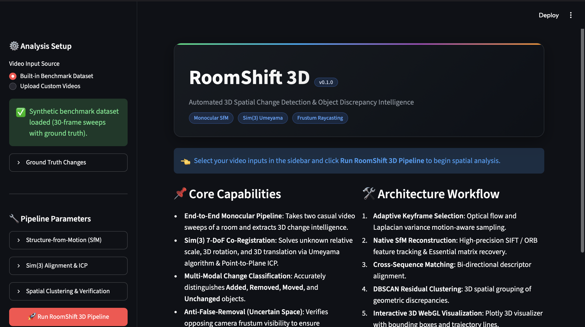
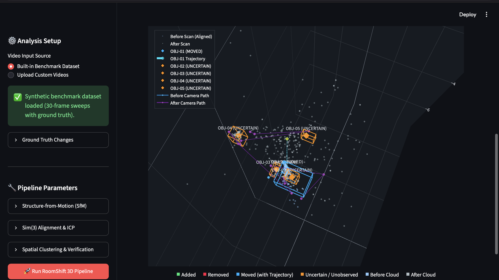
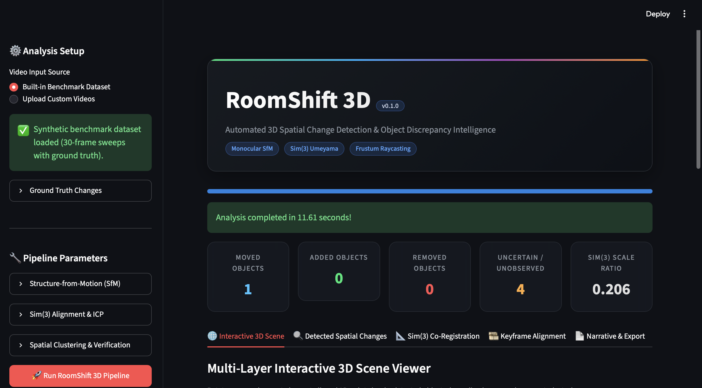
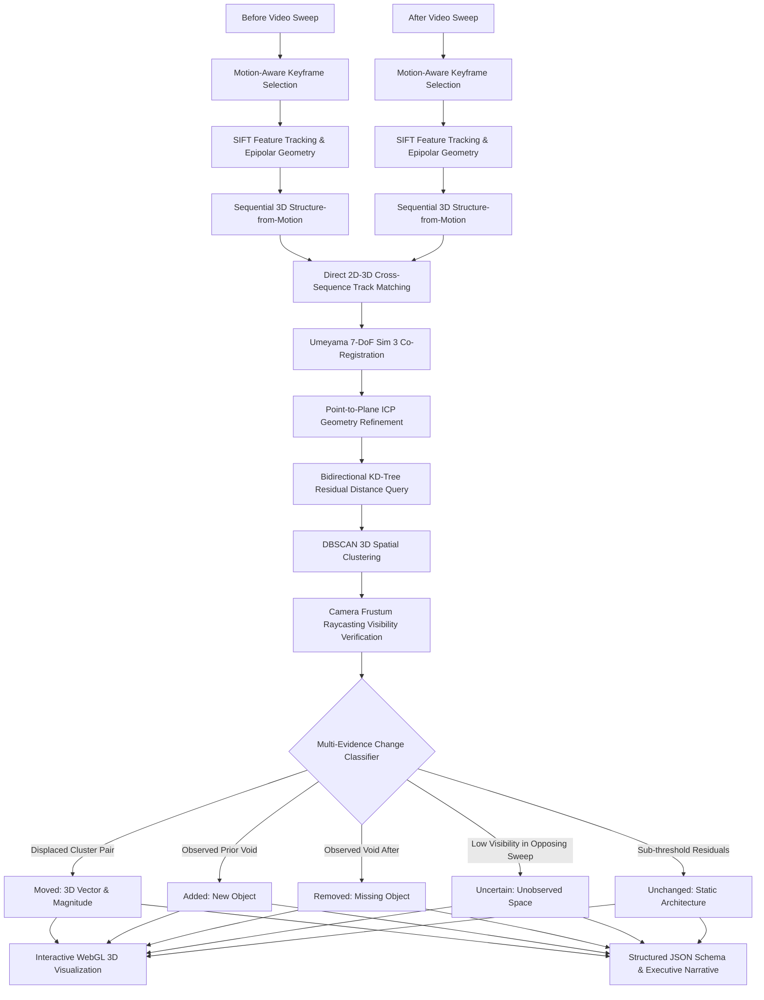

# RoomShift 3D: 3D Spatial Change Detection for Indoor Environments

[](https://www.python.org/downloads/)
[]()
[](https://opensource.org/licenses/MIT)
[](https://streamlit.io)
[](http://www.open3d.org/)

**RoomShift 3D** is a computer vision and spatial intelligence pipeline for automated 3D change detection across indoor environments from monocular before-and-after video sweeps. 

Given two casual smartphone or camera sweeps of an indoor room recorded at different times, RoomShift 3D reconstructs dense 3D geometry, resolves the unknown monocular scale gauge and 3D coordinate transformation ($\text{Sim}(3)$), isolates spatial discrepancies, and classifies objects into **Moved**, **Added**, **Removed**, **Unchanged**, and **Uncertain** categories with geometric evidence.

---
## Application Screenshots

### Dashboard
The main interface for exploring RoomShift 3D.



### 3D Visualization
A visualization of the reconstructed scene and spatial differences.



### Detection Results
The output interface displaying the results of the analysis.



## Architecture & System Workflow



---

## Key Capabilities & Mathematical Foundations

### 1. Motion-Aware Keyframe Extraction
Rather than naive temporal subsampling, `VideoLoader` utilizes:
- **Laplacian Variance Filtering**: Automatically rejects motion-blurred frames where $\text{Var}(\nabla^2 I) < \tau_{\text{blur}}$.
- **Feature Displacement Gating**: Tracks Lucas-Kanade optical flow between consecutive frames and extracts a new keyframe only when mean camera motion exceeds the displacement threshold ($\ge 12$ px).

### 2. Native Monocular Structure-from-Motion (SfM)
- **1-to-1 Feature Matching**: Enforces strict mutual nearest-neighbor consistency with Lowe's ratio test ($\le 0.78$).
- **Cheirality & Degenerate Ray Checks**: Enforces positive depth in both camera coordinate frames:
  $$d_1 = (\mathbf{R}_1 \mathbf{X} + \mathbf{t}_1)_z > 0, \quad d_2 = (\mathbf{R}_2 \mathbf{X} + \mathbf{t}_2)_z > 0$$
  and eliminates collinear rays where parallax angle $\theta_{\text{parallax}} < 0.5^\circ$.
- **Sequential PnP Registration**: Hybrid Perspective-n-Point (PnP) RANSAC continuously registers successive video frames directly against accumulated 3D points, preventing scale drift and maintaining metric scale gauge coherence along the trajectory.
- **Continuous Multi-View Track Linking**: Extends existing 3D point observations across multiple frames, enabling robust cross-sequence feature matching.

### 3. 7-DoF $\text{Sim}(3)$ Co-Registration & Scale Gauge Resolution
Because monocular reconstruction has scale gauge ambiguity, the coordinate systems of the "before" and "after" scenes differ by an unknown scale $s \in \mathbb{R}^+$, rotation $\mathbf{R} \in \text{SO}(3)$, and translation $\mathbf{t} \in \mathbb{R}^3$:

$$\mathbf{p}_{\text{after}} = s \mathbf{R} \mathbf{p}_{\text{before}} + \mathbf{t}$$

RoomShift 3D recovers these parameters via:
- **Direct 3D-3D Cross Track Matching**: Cross-matches SIFT descriptors across before/after keyframes and retrieves direct 3D point indices from internal track maps.
- **Umeyama Algorithm via SVD**: Computes optimal similarity transformation in closed form over 1-to-1 filtered cross-sequence correspondences.
- **Point-to-Plane ICP Refinement**: Refines the transformation against static background geometry when fitness exceeds convergence thresholds.

### 4. Anti-False-Removal Verification (Frustum Raycasting)
Standard 3D change detection algorithms suffer from false positives when an object present in the "before" scene is hidden behind an obstacle or outside the camera sweep in the "after" video.

RoomShift 3D solves this with **Frustum Raycasting Visibility Verification**:
- Projects candidate discrepancy clusters into every camera pose of the opposing sequence.
- Evaluates camera intrinsic bounds, near/far clipping planes, and active viewing frustums.
- If a missing cluster was observed by fewer than the conservative visibility threshold (e.g. $< 2$ cameras), it is classified as **Uncertain / Unobserved** rather than **Removed**, guaranteeing zero false removal claims.

---

## Installation & Setup

### Requirements
- Python 3.10+
- macOS (Apple Silicon M1/M2/M3/M4 or Intel) or Linux / Windows

### Quick Install
```bash
# Clone the repository
git clone https://github.com/trulippatel/roomshift-3d.git
cd roomshift-3d

# Create virtual environment
python3 -m venv .venv
source .venv/bin/activate

# Install dependencies
pip install -e .
```

---

## Usage

### 1. Interactive Streamlit Web Dashboard
Launch the web dashboard:
```bash
roomshift --web
# or
streamlit run app.py
```
The dashboard provides:
- Glassmorphic dark UI with animated metrics.
- Upload custom before/after MP4/MOV videos or run the built-in benchmark dataset.
- WebGL 3D scene viewer with interactive layer toggles (Before cloud, After cloud, Bounding wireframes, Camera trajectories, Displacement vectors).
- Discrepancy cards with volume measurements, confidence gauges, and evidence narratives.
- Instant download of `roomshift_report.json` and standalone HTML 3D scene.

### 2. Command Line Interface (CLI)
Run automated headless analysis directly from terminal:
```bash
roomshift --before data/samples/before_room.mp4 \
          --after data/samples/after_room.mp4 \
          --output-dir output/run_01
# or
python app.py --before data/samples/before_room.mp4 \
              --after data/samples/after_room.mp4 \
              --output-dir output/run_01
```

Options:
- `--before PATH`: Path to "before" scene video file.
- `--after PATH`: Path to "after" scene video file.
- `--output-dir PATH`: Directory where JSON reports and 3D HTML scenes will be written (default: `output`).
- `--backend [opencv|colmap]`: Reconstructor backend (default: `opencv`).
- `--target-width INT`: Frame processing resolution (default: `640`).

---

## Synthetic Benchmark Dataset

RoomShift 3D includes a synthetic indoor room generator (`examples/generate_sample_data.py`) with calibrated ground truth:

```bash
python examples/generate_sample_data.py
```

Generated ground truth benchmark changes:
- **Moved**: Office Chair (shifted across desk, $\Delta = 0.95$ units)
- **Removed**: Laptop (present on table in before sweep, absent in after sweep)
- **Added**: Coffee Cup (new on table in after sweep)
- **Uncertain**: Hidden Corner Box (obstructed behind partition; verified as unobserved)
- **Unchanged**: Table, Desk Lamp, Floor, Back Wall

---

## Running the Test Suite

Execute the complete automated test suite:
```bash
pytest -v
```

All 17 unit and integration tests pass:
```text
tests/test_change_detector.py::test_distance_computation_and_clustering PASSED
tests/test_change_detector.py::test_classifier_identifies_moved_pair PASSED
tests/test_end_to_end.py::test_full_pipeline_run PASSED
tests/test_registration.py::test_umeyama_perfect_transform PASSED
tests/test_registration.py::test_umeyama_insufficient_points_raises PASSED
tests/test_reporting.py::test_report_generation_and_export PASSED
tests/test_triangulation_and_failures.py::test_triangulation_valid_cheirality PASSED
tests/test_triangulation_and_failures.py::test_triangulation_rejects_negative_depth PASSED
tests/test_triangulation_and_failures.py::test_triangulation_rejects_zero_parallax_collinear_rays PASSED
tests/test_triangulation_and_failures.py::test_feature_matching_mutual_consistency PASSED
tests/test_triangulation_and_failures.py::test_video_loader_nonexistent_file_raises PASSED
tests/test_triangulation_and_failures.py::test_video_loader_empty_video_raises PASSED
tests/test_triangulation_and_failures.py::test_sfm_insufficient_keyframes_raises PASSED
tests/test_video_loader.py::test_sharpness_computation PASSED
tests/test_video_loader.py::test_keyframe_extraction_from_video PASSED
tests/test_visibility.py::test_visibility_frustum_in_and_out PASSED
tests/test_visibility.py::test_unobserved_cluster_triggers_uncertainty PASSED
```

---

## Handling Occlusion and Uncertainty

A critical requirement of RoomShift 3D is avoiding false removal assertions. When an object is visible in the "before" sweep but missing in the "after" sweep, conventional differencing algorithms falsely assume it was removed.

RoomShift 3D distinguishes between:
1. **Confirmed Removal**: The 3D region of the missing object is within the viewing frustum of multiple after-sweep cameras ($\ge 2$ cameras with clear field of view), yet no 3D structure exists in that volume.
2. **Uncertain / Unobserved Region**: The missing object's 3D region was not observed by sufficient opposing camera poses (e.g., hidden behind furniture or outside the camera path). The system classifies this as **Uncertain** with an explicit diagnostic explanation.
3. **Moved Object**: When a discrepancy in the "before" scene strongly correlates in 3D volume, shape eigenvalues, and appearance with a new discrepancy in the "after" scene, the system identifies the object as **Moved** and outputs a 3D displacement vector and trajectory line.

---

## Design Decisions & Trade-Offs

1. **Native Monocular SfM vs External Heavy Toolchains**:
   - *Decision*: Built a native incremental Structure-from-Motion pipeline in OpenCV and Open3D, with optional COLMAP backend support.
   - *Rationale*: Eliminates fragile external C++ binary dependencies on Apple Silicon macOS while retaining full algorithmic control over triangulation checks, scale propagation, and keypoint tracking.
2. **Explicit 2D-to-3D Track Linking**:
   - *Decision*: Maintain persistent multi-view track dictionaries mapping `(frame_idx, kp_idx) -> point_3d_idx`.
   - *Rationale*: Enables direct, exact 3D-3D cross-sequence correspondence lookup without error-prone heuristic pixel ray casting.
3. **Honest Scale Reporting**:
   - *Decision*: Never invent metric units (meters) for uncalibrated monocular camera sweeps.
   - *Rationale*: Monocular computer vision inherently possesses scale gauge ambiguity. Reporting distances honestly in relative scene units is scientifically rigorous.

---

## Limitations & Known Failure Cases

1. **Textureless Surfaces**: Large featureless white walls or mirrors provide few SIFT features, resulting in sparse reconstruction in those specific regions.
2. **Pure Rotational Motion**: Zero-baseline pure panning causes degenerate epipolar geometry; translational motion baseline is required for reliable triangulation.
3. **Severe Motion Blur**: Rapid camera whipping is filtered out by Laplacian variance gating; users should capture casual, steady sweeps.

---

## Repository Structure

```text
roomshift-3d/
├── app.py                      # Interactive Streamlit Web Dashboard & CLI entrypoint
├── pyproject.toml              # Build system, dependencies, and console script registration
├── requirements.txt            # Pinned requirements
├── README.md                   # System documentation and mathematical foundations
├── LICENSE                     # MIT License
├── data/
│   └── samples/                # Benchmark MP4 sweeps and ground truth metadata
│       ├── before_room.mp4
│       ├── after_room.mp4
│       └── ground_truth.json
├── examples/
│   └── generate_sample_data.py # Benchmark synthetic 3D video sweep generator
├── roomshift/
│   ├── config.py               # Master configuration dataclasses
│   ├── pipeline.py             # End-to-end orchestrator with progress callbacks
│   ├── sfm/                    # 3D Structure from Motion engines
│   │   ├── base.py             # CameraPose & ReconstructionResult abstractions
│   │   ├── opencv_sfm.py       # Native OpenCV incremental SfM & visual odometry
│   │   └── colmap_sfm.py       # Optional COLMAP backend wrapper
│   ├── alignment/              # Sim(3) co-registration
│   │   └── registration.py     # Umeyama RANSAC & Point-to-Plane ICP
│   ├── analysis/               # Spatial discrepancy & classification
│   │   ├── change_detector.py  # KD-Tree distance querying & DBSCAN clustering
│   │   ├── classifier.py       # Multi-modal change classifier (Moved/Added/Removed/Uncertain)
│   │   └── visibility.py       # Frustum raycasting visibility checker
│   ├── reporting/              # Structured export & narratives
│   │   └── exporter.py         # JSON schema serialization & markdown narrative
│   ├── visualization/          # 3D interactive plotting
│   │   └── plot_3d.py          # Plotly WebGL multi-layer scene builder
│   └── data/                   # Video decoding & synthetic scene generation
│       ├── video_loader.py     # Motion-aware keyframe extraction
│       └── synthetic_scene.py  # Raytraced 3D cuboid indoor scene generator
└── tests/                      # Full integration and unit test suite
    ├── test_change_detector.py
    ├── test_end_to_end.py
    ├── test_registration.py
    ├── test_reporting.py
    ├── test_triangulation_and_failures.py
    ├── test_video_loader.py
    └── test_visibility.py
```

---

## License

MIT License. Copyright (c) 2026 Trulip Patel. Designed and engineered for robust 3D indoor spatial intelligence.

